<div align="center">


# Promise Keeper for Gmail

**Most email tools read your inbox. Promise Keeper also reads your Sent folder.**<br>
It finds what *you* promised, what others asked of *you*, hard deadlines, and what people owe *you* — then helps you keep every one.

<br>

<a href="docs/promo/promise-keeper-promo.mp4">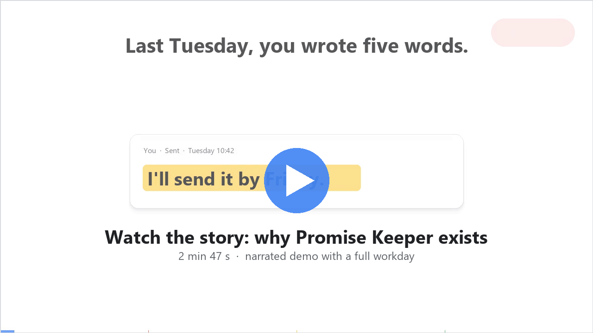</a>

<sub><b>Watch the story</b> (narrated, 2:47) · <a href="docs/promo/narration.md">script</a> · quick silent version below</sub>

<br>

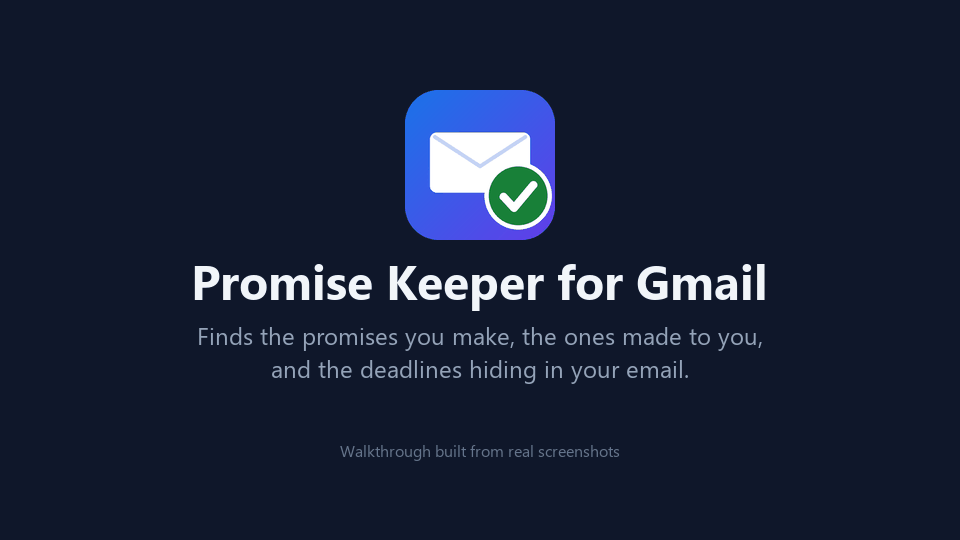

<sub>Walkthrough built from real screenshots. Want to see it live? <a href="docs/demo-script.md">Recording script</a>.</sub>

<br>


[The problem](#-the-problem) · [See it work](#-see-it-work) · [The numbers](#-does-it-actually-work-the-numbers) · [How it works](#-how-it-works) · [Features](#-features) · [Architecture](#-architecture) · [Quick start](#-quick-start) · [Security](#-security--privacy) · [Status](#-project-status)

</div>

---

## 💡 The problem

Work runs on email, and email is a terrible place to keep commitments.

- You write *"I'll send the deck by Friday"* in a reply, close the tab, and it exists nowhere else.
- A client writes *"Can you review this by EOD?"* between 40 other messages.
- Someone tells you *"Report is on the way"*, then goes quiet, and nothing reminds you to chase.

To-do apps only know what you type into them. Gmail's own tools look at your **Inbox**. The promises *you* make live in your **Sent** folder, and nothing reads that. Missed commitments cost trust, deals and time, and almost nobody tracks them reliably.

**Promise Keeper reads both sides of your mail, finds every commitment, and turns each into one line you can accept, edit or dismiss:**

| It finds | Example sentence | What happens when you accept |
| --- | --- | --- |
| 🟣 **My promise** | "I'll send you the deck by Friday" | Google Task with a link back to the email |
| 🟠 **Request to me** | "Can you review the draft by EOD?" | Google Task |
| 🔴 **Deadline** | "Semester fee due 20 Nov" | Task **and** an all-day Calendar event |
| 🔵 **Waiting on** | "Report is on the way" (they owe *you*) | Task, plus a one-tap follow-up **draft** you review before sending |

Every item shows the **exact sentence from the email that triggered it**, so you can trust it at a glance. Nothing is added without your say-so, and it understands Hinglish too ("theek hai, kal tak bhej dunga").

**Who it's for:** founders, freelancers, managers and anyone whose commitments live in their inbox.

---

## 👀 See it work

**Open an email: the promise is already extracted, with the sentence that proves it.** Accept it, edit it, draft a follow-up, or dismiss it, without leaving Gmail.

<p align="center">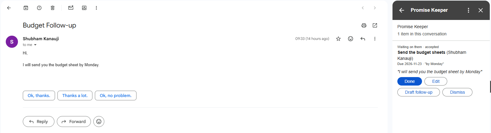</p>

<table>
<tr>
<td align="center" width="34%"><b>Home card</b><br>what's open, overdue, and who owes you<br><br>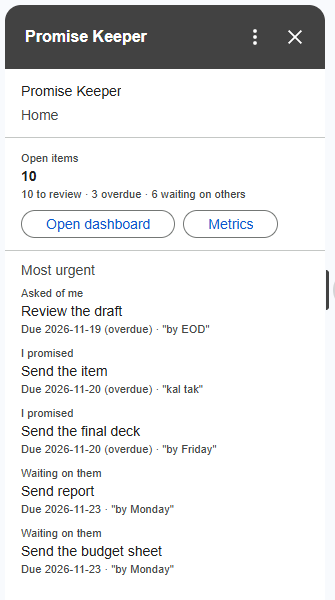</td>
<td align="center" width="66%"><b>Morning digest</b><br>one email: overdue · today · this week · waiting on others<br><br>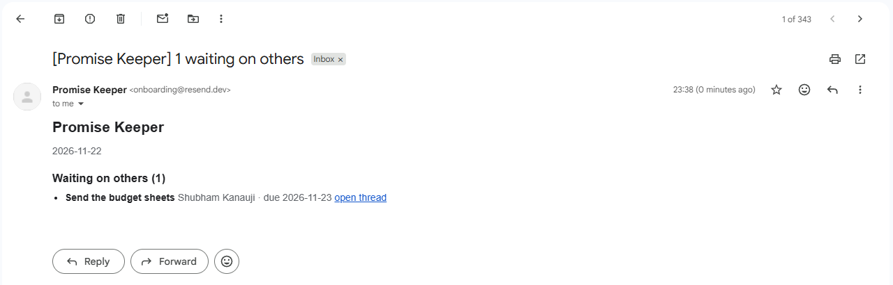</td>
</tr>
</table>

<p align="center"><b>The same items on the web dashboard</b> (Accept / Edit / Draft follow-up / Dismiss)<br><br>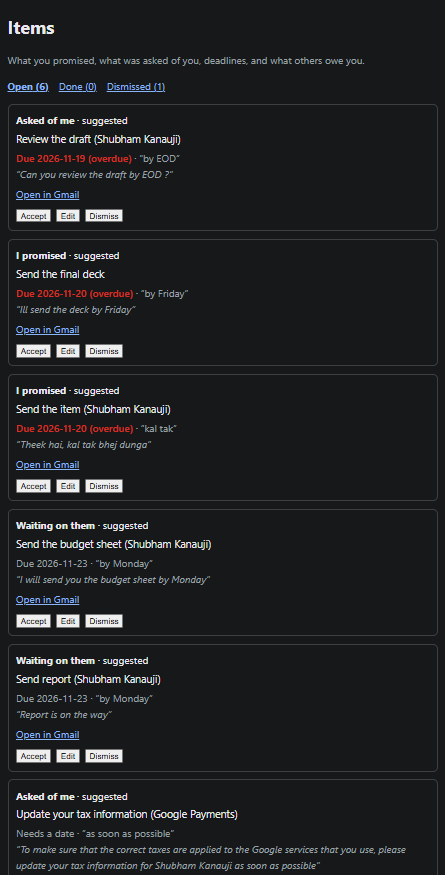</p>

---

## 📊 Does it actually work? The numbers

A tool that reads your mail has to earn trust, so every prompt change is scored against **106 real emails I labelled by hand**. Most of them (97) contain *nothing* to extract: marketing mail, automated notifications, everyday human messages and five deliberate traps. That is on purpose. It makes **false alarms measurable**, which is what decides whether you keep using a tool like this.

<p align="center">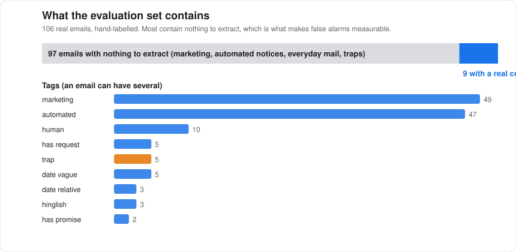</p>

| Metric (prompt v2, 106 labelled emails) | Result | What it means |
| --- | --- | --- |
| **Precision** | **100%** (7 of 7 shown items correct) | It raised **0 false alarms** across 97 emails that had no commitment |
| **Recall** | **77.8%** (7 of 9 real commitments found) | It misses roughly 1 in 5 |
| **Date accuracy** | **100%** | Due dates (including "Friday", "by Monday", "kal tak") resolved correctly |
| **Gate** (precision ≥ 85% **and** date accuracy ≥ 85%) | ✅ **PASS** | The bar a prompt must clear before it ships |

**Iterating on evidence, not vibes.** The first prompt failed the gate (precision 83%, recall 56%). Reading the individual misses led to prompt v2: it stops treating promotional deadlines as tasks and counts automated action-required notices as requests. Precision went **83% → 100%** and recall **56% → 78%** (last v1 run on 101 labelled emails, first full v2 run on 106).

<p align="center">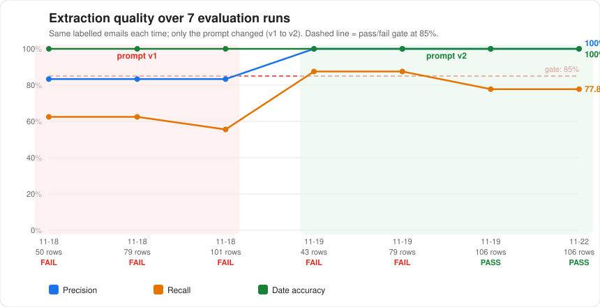</p>

| Item type | Found | Missed | False alarms |
| --- | --- | --- | --- |
| My promise | 2 | 0 | 0 |
| Deadline | 1 | 0 | 0 |
| Request to me | 4 | 1 | 0 |
| Waiting on | 0 | 1 | 0 |

**Same results on both runtimes.** The Stage B web app re-ran the evaluation through its own pipeline and reproduced the Apps Script add-on's numbers **exactly** (precision 1.0, recall 0.778, date accuracy 1.0). That is the point of sharing the extraction modules between the two.

<p align="center">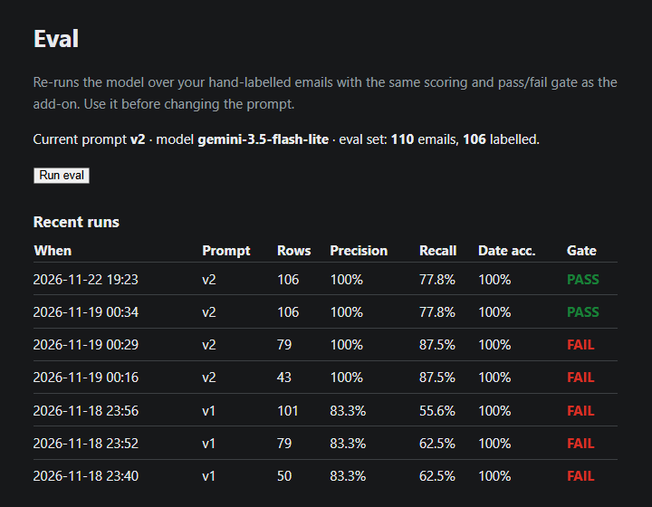</p>

> **Honest limits.** Only **9 of the 106 emails contain a real commitment**, so recall rests on 9 examples and one more miss would move it by about 11 points. The strong claim is the *zero false alarms across 97 emails*; the recall figure is directional. The synthetic test below adds weight, and growing the set of real positive examples is the next measurement step. Real-world acceptance and on-time rates need weeks of use and are tracked on the `/metrics` page.

### A second, larger test: 76 synthetic emails

Because the real set has only 9 positives, I wrote **76 invented emails** with answers worked out from the prompt's date rules *before* running anything: 49 contain real commitments (**53 expected items**: 19 promises, 14 requests, 7 deadlines, 13 waiting-on), 27 contain nothing (polite replies, OTPs, receipts, past events, hypotheticals, and five promo traps such as "Apply now, closes 30 Nov"). They cover Hinglish and emails with several items. They run through the **same prompt, validation and scoring code** as the app, and **the prompt was not changed after seeing the results** (still v2).

<p align="center">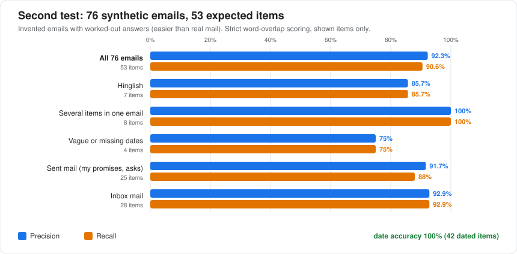</p>

| Strict scoring (word-overlap match) | Result |
| --- | --- |
| Precision | **92.3%** (48 correct, 4 flagged as false alarms) |
| Recall | **90.6%** (48 of 53 found) |
| Date accuracy | **100%** (42 of 42 dated items correct, including "next Tuesday", "end of week", "in 3 days", "kal tak") |
| Gate | ✅ PASS |

| Item type | Found | Missed | False alarms |
| --- | --- | --- | --- |
| My promise | 17 | 2 | 2 |
| Request to me | 14 | 0 | 0 |
| Deadline | 6 | 1 | 1 |
| Waiting on | 11 | 2 | 1 |

**Reading the 4 "false alarms" and 5 "misses" honestly.** I listed every one. Four of the four false alarms and four of the five misses are the *same four emails*: the model found the right commitment, with the right date, but phrased it differently from my label, and the scorer matches on word overlap, so each counted twice. For example the model wrote "Have the audit summary ready" where I wrote "Prepare audit summary", and "Get back with the quote" where I wrote "Send quote". Judged by meaning, those four are correct. That leaves **one genuine miss** ("Can you confirm the booking in 2 days?" in a sent mail) and **zero invented items**. I report the strict numbers above as the result and the by-meaning reading as context. I am the one who wrote the labels, so treat the second reading as less independent.

**Why this test is easier than real mail.** The emails are short and clean, I wrote the prompt and the cases, and some phrasings echo patterns the prompt describes. It answers a different question than the real set: *does the extractor handle each kind of commitment, date style and language?* The real 106-email set stays the pass/fail gate for prompt changes. Reproduce with `node eval/build-synthetic.js` and `node eval/run-synthetic.js`; every miss is listed in [`eval/synthetic-results.json`](eval/synthetic-results.json).


---

## ✨ Features

- **Reads both sides of the conversation** — Inbox *and* Sent, grounded in the exact sentence that triggered each item.
- **Gmail sidebar** — Accept, Edit or Dismiss right next to the email you have open.
- **Google Tasks + Calendar** — accepted items become tasks; deadlines become all-day calendar events. Idempotent: never a duplicate.
- **Morning digest** — one email with *overdue · today · this week · waiting on others*, with open and click tracking.
- **One-tap nudge drafts** — a polite follow-up is created as a **Gmail draft**. It never sends on your behalf.
- **"Did they deliver?"** — when a counterparty replies in a thread you were waiting on, the item is flagged for you.
- **Honest accuracy** — an evaluation harness with a pass/fail gate measures precision, recall and date accuracy before any prompt change ships.
- **Metrics that matter** — accept rate, edit rate, on-time rate (week 1 vs week 4), digest retention (D7/D30).
- **Web dashboard** — `/items`, `/metrics` and `/settings` (including **Delete my data**) for the same data.
- **Privacy first** — full email bodies are **never stored**; refresh tokens are encrypted at rest.

---

## 🔍 How it works

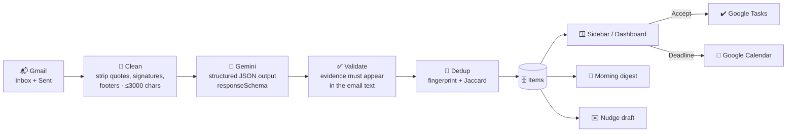

The trick that keeps it trustworthy: **every extracted item must carry an evidence sentence that literally appears in the cleaned email.** Anything the model invents is dropped before you ever see it.

---

## 🏗️ Architecture

The same pure JavaScript modules in [`shared/`](shared) power **both** runtimes, so extraction behaves identically everywhere — proven by running the same logic and tests on each side.

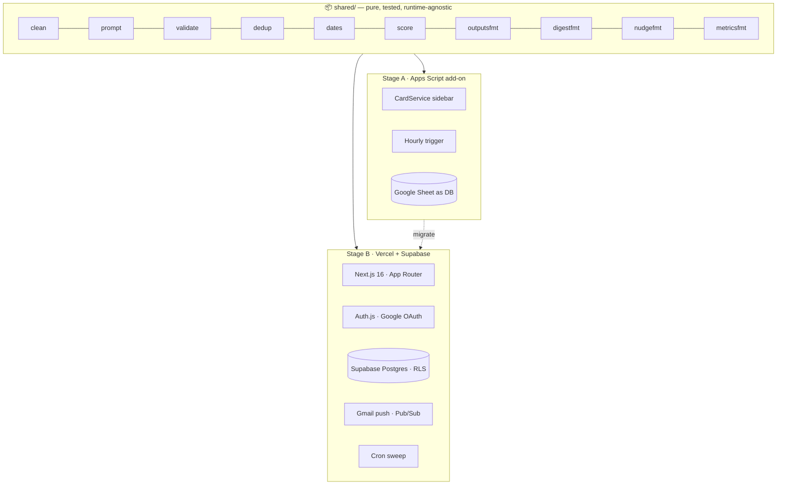

| | **Stage A — Apps Script add-on** | **Stage B — Vercel + Supabase** |
| --- | --- | --- |
| UI | Gmail sidebar (CardService) | Gmail sidebar (alternate runtime) + web dashboard |
| Storage | Google Sheet | Postgres with row-level security |
| Trigger | Hourly time-based trigger | Gmail push (Pub/Sub) + scheduled sweep |
| Auth | Add-on scopes | Auth.js Google OAuth, offline refresh token (AES-256-GCM) |
| Users | Single user | Multi-user |
| Status | ✅ Complete and verified | ✅ Live (test users only) |

### Tech stack

**Add-on:** Google Apps Script · CardService · Advanced Gmail / Tasks / Calendar services · `clasp`
**Web:** Next.js 16 (App Router) · TypeScript · Auth.js (`next-auth@beta`) · Supabase (Postgres + RLS) · Vercel
**AI:** Gemini `gemini-3.5-flash-lite` with a JSON `responseSchema` · temperature 0
**Quality:** Jest (shared modules run in Node and in Apps Script)

---

## 📁 Project structure

```text
.
├── shared/            # Pure JS modules used by BOTH runtimes (single source of truth)
├── addon/src/         # Apps Script add-on (shared files are copied in by scripts/copy-shared.js)
├── web/               # Next.js app: sign-in, dashboard, intake pipeline, API routes
│   ├── app/           #   pages: /items /metrics /settings /privacy /data-deletion + api/
│   └── lib/           #   gmail/gemini/tasks clients, extraction, actions, crypto, jwt
├── supabase/          # SQL migrations (schema + row-level security)
├── scripts/           # build helpers
├── tests/             # Jest suite for the shared modules
└── docs/              # setup guides
```

---

## 🚀 Quick start

### Stage A — the Gmail add-on

1. Install dependencies and push the add-on:
   ```bash
   npm install
   npx clasp login            # one-time Google sign-in
   npm run push               # copies shared/*.js into addon/src, then clasp push
   ```
2. In the Apps Script editor set **Script properties**: `GEMINI_API_KEY`.
3. Run `setupDb` once, then deploy as a **Test deployment → Google Workspace Add-on**.

Full walkthrough for installing on another Google account: [`docs/tester-setup.md`](docs/tester-setup.md).

### Stage B — the web app

1. Create a Supabase project and run [`supabase/migrations/0001_init.sql`](supabase/migrations/0001_init.sql).
2. Create a Google OAuth **Web application** client with the redirect `http://localhost:3000/api/auth/callback/google`.
3. Copy `web/.env.example` to `web/.env.local` and fill it in.
4. Run it:
   ```bash
   cd web
   npm install
   npm run dev                # http://localhost:3000
   ```

Click-by-click guides: [`docs/stage-b-setup.md`](docs/stage-b-setup.md) (accounts and local run) and [`docs/sidebar-setup.md`](docs/sidebar-setup.md) (Gmail sidebar from Vercel).

### Tests

```bash
npm test                       # 89 tests · shared modules and the Sheet migration parser
cd web && npm test             # 67 tests · crypto, JWT, add-on token checks, cards, digest, nudge, eval, extraction, deletion
```

---

## 🔐 Security & privacy

| Concern | What Promise Keeper does |
| --- | --- |
| **Email content** | Cleaned text (≤ ~3,000 chars) goes to Gemini; attachments never do. **Full bodies are never stored** — only the extracted fields and one evidence sentence. |
| **Refresh tokens** | Encrypted with **AES-256-GCM** (fresh IV per value), key held in an env var. The `oauth_tokens` table has **no RLS policy**, so a user token can never read it. |
| **Database access** | **Row-level security** on every user table, keyed by a short-lived server-signed JWT (`sub` = user id). |
| **Gmail scopes** | `gmail.readonly` + `gmail.compose` (drafts only). It cannot send, delete or modify your mail. |
| **Endpoints** | Cron and push endpoints require a shared secret compared in constant time. |
| **Deletion** | **Settings → Delete my data** removes every row and token. A log keeps only a one-way hash of the user id and row counts — never an email address. |
| **Limited Use** | Follows the Google API Services User Data Policy, including Limited Use. See the in-app `/privacy` page. |

> ⚠️ **Gemini tier matters.** The free tier is rate-limited and may use inputs to improve Google products. Use a **paid-tier key** before processing anyone else's mail.

---

## 📍 Project status

> **All 8 phases (0–7) are complete.** Stage A (Apps Script add-on) and Stage B (Vercel + Supabase) are both built, tested and verified live with test users.

| Phase | Scope | State |
| --- | --- | --- |
| 0–6 | Add-on: extraction, evaluation gate, Tasks/Calendar, sidebar, morning digest, nudges, metrics, onboarding | ✅ Complete and verified |
| 7 · Stage 1 | Next.js foundation, Postgres schema + RLS, token encryption, privacy pages | ✅ Done |
| 7 · Stage 2 | Google sign-in, encrypted token storage, Settings, **Delete my data** (verified with a second account) | ✅ Done |
| 7 · Stage 3 | Gmail intake: Pub/Sub push (new mail becomes an item within seconds), queue, 5-minute sweep (Supabase pg_cron) | ✅ Live on Vercel |
| 7 · Stage 4 | Gmail sidebar served from Vercel (HTTP add-on, Google-signed requests verified) | ✅ Live |
| 7 · Stage 5 | Dashboard: Items (Accept/Edit/Dismiss/Done → Tasks + Calendar), Metrics, Eval | ✅ Done |
| 7 · Stage 6 | Morning digest via Resend with signed open/click tracking · one-tap nudge drafts | ✅ Done |
| 7 · Stage 7 | Sheet → Postgres migration · Eval gate re-run on the web pipeline (**same result as the add-on: P 1.0, R 0.778, date acc 1.0, PASS**) | ✅ Done |
| After the build | *Optional, only for a public launch:* Google OAuth verification + CASA security assessment — see [docs/google-verification.md](docs/google-verification.md) | Not part of the 8 phases |

### Known limits

- The digest click redirect needs one extra click (Apps Script sandbox).
- Google Tasks notes are plain text, so the email link is not clickable there (it is in Calendar).
- Metrics such as week-4 on-time rate and D7/D30 retention need time to become measurable.
- The evaluation set is small and was tuned on itself; treat the numbers as a regression gate, not a benchmark.
- Free Gemini tier: rate-limited (about 13 calls a minute) and not suitable for other people's mail. Use a paid-tier key before inviting testers.
- Resend's free plan only delivers to the account owner until a sending domain is verified.
- Google verification for the restricted Gmail scopes (and a security assessment) is required before public launch.

---

<div align="center">

Built with care to make sure the small promises don't slip. 🤝

</div>
