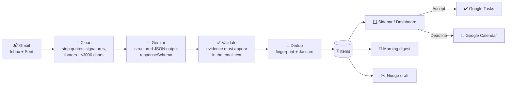
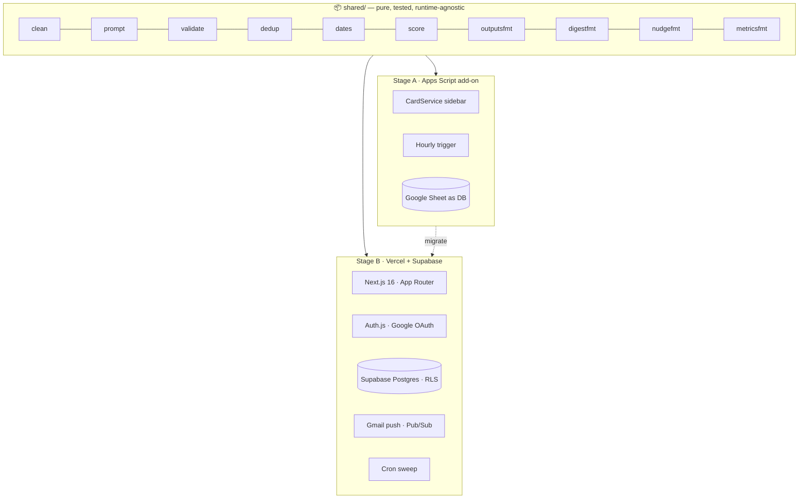

<div align="center">

# 🤝 Promise Keeper for Gmail

**Most email tools read your inbox. Promise Keeper also reads your Sent folder.**<br>
It finds what *you* promised, what others asked of *you*, hard deadlines, and what people owe *you* — then helps you keep every one.

<br>


[How it works](#-how-it-works) · [Features](#-features) · [Architecture](#-architecture) · [Quick start](#-quick-start) · [Security](#-security--privacy) · [Status](#-project-status)

</div>

---

## 💡 The idea

A missed promise costs trust, and promises hide in plain sight: *"I'll send the deck by Friday"* in a Sent email, *"Can you review this by EOD?"* in an Inbox email, *"Report is on the way"* from someone who then goes quiet.

Promise Keeper turns those sentences into a small, honest to-do list:

| It finds | Example | Where it lives |
| --- | --- | --- |
| 🟣 **My promise** | "I'll send you the deck by Friday" | Tasks, with a link back to the email |
| 🟠 **Request to me** | "Can you review the draft by EOD?" | Tasks |
| 🔴 **Deadline** | "Semester fee due 20 Nov" | Tasks **and** Calendar |
| 🔵 **Waiting on** | "Report is on the way" (they owe you) | Tasks, with a follow-up nudge |

Nothing is added without your say-so: **you press Accept, Edit or Dismiss.** It even understands Hinglish ("theek hai, kal tak bhej dunga").

---

## ✨ Features

- **Reads both sides of the conversation** — Inbox *and* Sent, grounded in the exact sentence that triggered each item.
- **Gmail sidebar** — Accept, Edit or Dismiss right next to the email you have open.
- **Google Tasks + Calendar** — accepted items become tasks; deadlines become all-day calendar events. Idempotent: never a duplicate.
- **Morning digest** — one email with *overdue · today · this week · waiting on others*, with open and click tracking.
- **One-tap nudge drafts** — a polite follow-up is created as a **Gmail draft**. It never sends on your behalf.
- **"Did they deliver?"** — when a counterparty replies in a thread you were waiting on, the item is flagged for you.
- **Honest accuracy** — an evaluation harness with a pass/fail gate measures precision, recall and date accuracy before any prompt change ships.
- **Metrics that matter** — accept rate, edit rate, on-time rate (week 1 vs week 4), digest retention (D7/D30).
- **Web dashboard** — `/items`, `/metrics` and `/settings` (including **Delete my data**) for the same data.
- **Privacy first** — full email bodies are **never stored**; refresh tokens are encrypted at rest.

---

## 🔍 How it works



The trick that keeps it trustworthy: **every extracted item must carry an evidence sentence that literally appears in the cleaned email.** Anything the model invents is dropped before you ever see it.

---

## 🏗️ Architecture

The same pure JavaScript modules in [`shared/`](shared) power **both** runtimes, so extraction behaves identically everywhere — proven by running the same logic and tests on each side.



| | **Stage A — Apps Script add-on** | **Stage B — Vercel + Supabase** |
| --- | --- | --- |
| UI | Gmail sidebar (CardService) | Gmail sidebar (alternate runtime) + web dashboard |
| Storage | Google Sheet | Postgres with row-level security |
| Trigger | Hourly time-based trigger | Gmail push (Pub/Sub) + scheduled sweep |
| Auth | Add-on scopes | Auth.js Google OAuth, offline refresh token (AES-256-GCM) |
| Users | Single user | Multi-user |
| Status | ✅ Complete and verified | ✅ Live (test users only) |

### Tech stack

**Add-on:** Google Apps Script · CardService · Advanced Gmail / Tasks / Calendar services · `clasp`
**Web:** Next.js 16 (App Router) · TypeScript · Auth.js (`next-auth@beta`) · Supabase (Postgres + RLS) · Vercel
**AI:** Gemini `gemini-3.5-flash-lite` with a JSON `responseSchema` · temperature 0
**Quality:** Jest (shared modules run in Node and in Apps Script)

---

## 📁 Project structure

```text
.
├── shared/            # Pure JS modules used by BOTH runtimes (single source of truth)
├── addon/src/         # Apps Script add-on (shared files are copied in by scripts/copy-shared.js)
├── web/               # Next.js app: sign-in, dashboard, intake pipeline, API routes
│   ├── app/           #   pages: /items /metrics /settings /privacy /data-deletion + api/
│   └── lib/           #   gmail/gemini/tasks clients, extraction, actions, crypto, jwt
├── supabase/          # SQL migrations (schema + row-level security)
├── scripts/           # build helpers
├── tests/             # Jest suite for the shared modules
└── docs/              # setup guides
```

---

## 🚀 Quick start

### Stage A — the Gmail add-on

1. Install dependencies and push the add-on:
   ```bash
   npm install
   npx clasp login            # one-time Google sign-in
   npm run push               # copies shared/*.js into addon/src, then clasp push
   ```
2. In the Apps Script editor set **Script properties**: `GEMINI_API_KEY`.
3. Run `setupDb` once, then deploy as a **Test deployment → Google Workspace Add-on**.

Full walkthrough for installing on another Google account: [`docs/tester-setup.md`](docs/tester-setup.md).

### Stage B — the web app

1. Create a Supabase project and run [`supabase/migrations/0001_init.sql`](supabase/migrations/0001_init.sql).
2. Create a Google OAuth **Web application** client with the redirect `http://localhost:3000/api/auth/callback/google`.
3. Copy `web/.env.example` to `web/.env.local` and fill it in.
4. Run it:
   ```bash
   cd web
   npm install
   npm run dev                # http://localhost:3000
   ```

Click-by-click guides: [`docs/stage-b-setup.md`](docs/stage-b-setup.md) (accounts and local run) and [`docs/sidebar-setup.md`](docs/sidebar-setup.md) (Gmail sidebar from Vercel).

### Tests

```bash
npm test                       # 89 tests · shared modules and the Sheet migration parser
cd web && npm test             # 63 tests · crypto, JWT, add-on token checks, cards, digest, nudge, eval, extraction, deletion
```

---

## 🔐 Security & privacy

| Concern | What Promise Keeper does |
| --- | --- |
| **Email content** | Cleaned text (≤ ~3,000 chars) goes to Gemini; attachments never do. **Full bodies are never stored** — only the extracted fields and one evidence sentence. |
| **Refresh tokens** | Encrypted with **AES-256-GCM** (fresh IV per value), key held in an env var. The `oauth_tokens` table has **no RLS policy**, so a user token can never read it. |
| **Database access** | **Row-level security** on every user table, keyed by a short-lived server-signed JWT (`sub` = user id). |
| **Gmail scopes** | `gmail.readonly` + `gmail.compose` (drafts only). It cannot send, delete or modify your mail. |
| **Endpoints** | Cron and push endpoints require a shared secret compared in constant time. |
| **Deletion** | **Settings → Delete my data** removes every row and token. A log keeps only a one-way hash of the user id and row counts — never an email address. |
| **Limited Use** | Follows the Google API Services User Data Policy, including Limited Use. See the in-app `/privacy` page. |

> ⚠️ **Gemini tier matters.** The free tier is rate-limited and may use inputs to improve Google products. Use a **paid-tier key** before processing anyone else's mail.

---

## 📍 Project status

| Phase | Scope | State |
| --- | --- | --- |
| 0–6 | Add-on: extraction, evaluation gate, Tasks/Calendar, sidebar, morning digest, nudges, metrics, onboarding | ✅ Complete and verified |
| 7 · Stage 1 | Next.js foundation, Postgres schema + RLS, token encryption, privacy pages | ✅ Done |
| 7 · Stage 2 | Google sign-in, encrypted token storage, Settings, **Delete my data** (verified with a second account) | ✅ Done |
| 7 · Stage 3 | Gmail intake: Pub/Sub push (new mail becomes an item within seconds), queue, 5-minute sweep (Supabase pg_cron) | ✅ Live on Vercel |
| 7 · Stage 4 | Gmail sidebar served from Vercel (HTTP add-on, Google-signed requests verified) | ✅ Live |
| 7 · Stage 5 | Dashboard: Items (Accept/Edit/Dismiss/Done → Tasks + Calendar), Metrics, Eval | ✅ Done |
| 7 · Stage 6 | Morning digest via Resend with signed open/click tracking · one-tap nudge drafts | ✅ Done |
| 7 · Stage 7 | Sheet → Postgres migration · Eval gate re-run on the web pipeline (**same result as the add-on: P 1.0, R 0.778, date acc 1.0, PASS**) | ✅ Done |
| Next | Google OAuth verification + CASA security assessment for public launch — see [docs/google-verification.md](docs/google-verification.md) | ⏳ Not started |

### Known limits

- The digest click redirect needs one extra click (Apps Script sandbox).
- Google Tasks notes are plain text, so the email link is not clickable there (it is in Calendar).
- Metrics such as week-4 on-time rate and D7/D30 retention need time to become measurable.
- The evaluation set is small and was tuned on itself; treat the numbers as a regression gate, not a benchmark.
- Free Gemini tier: rate-limited (about 13 calls a minute) and not suitable for other people's mail. Use a paid-tier key before inviting testers.
- Resend's free plan only delivers to the account owner until a sending domain is verified.
- Google verification for the restricted Gmail scopes (and a security assessment) is required before public launch.

---

<div align="center">

Built with care to make sure the small promises don't slip. 🤝

</div>
